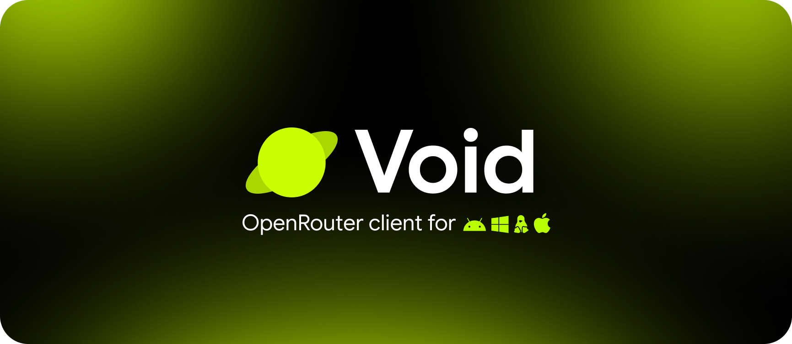
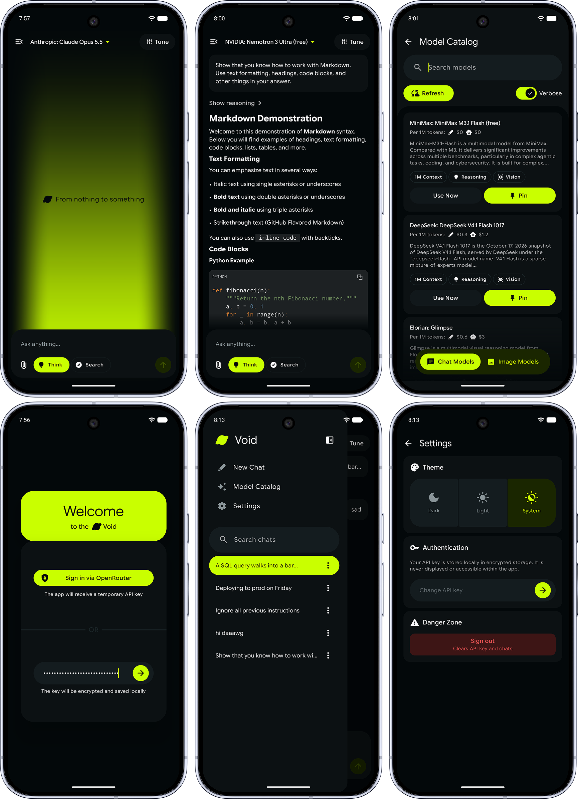
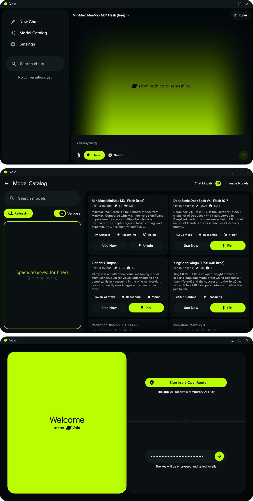
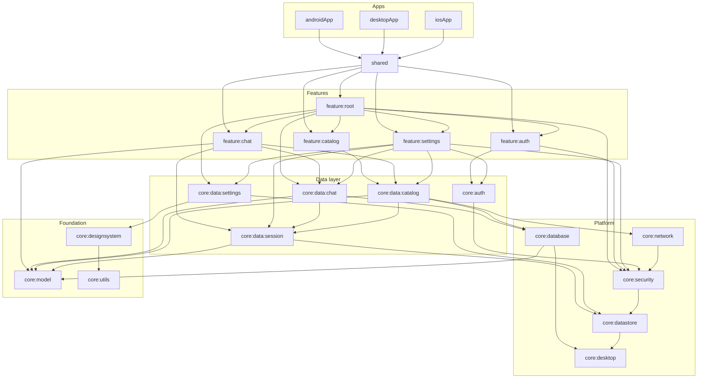

Void is a chat client for the [OpenRouter](https://openrouter.ai) API: browse the full model
catalog, pin your favorites, and talk to any of them: all from a single app that runs on
**Android**, **iOS** and **Desktop** (Windows, macOS, Linux) from one shared codebase.

<br>


**This is a learning / portfolio project.** It is not an actively maintained product. You are very
welcome to **fork or clone** the repository and take it in your own direction.

<br>


#### Chat

- Conversations and messages are stored locally
- Streaming responses
- Thinking (reasoning) and web search support
- Regenerate the last response
- Graceful error handling: failed generations are kept in the conversation and can be retried
- Pin your favorite models and switch between them quickly

#### Model Catalog

- Loads all OpenRouter models: both **Chat** and **Image** models
- Search for a model, then use it right away or pin it for later
- Shows each model's name, context window and price per 1M tokens

#### Settings

- Theme: **Light**, **Dark** or **System** (default)
- Change the API key
- Log out: wipes all chats, models and the API key from the device

#### Auth

The entry point on first launch. Two ways to sign in:

- **OAuth 2.0 with PKCE:** you authorize in the browser, no copy-pasting needed.
- **Manual API key:** paste your own key. It goes straight into secure storage and no third-party
  page is involved.

<details>
<summary><b>How the OAuth flow works (and why it's safe)</b></summary>

<br>

1. The app opens OpenRouter's authorization page in your browser.
2. After you approve, OpenRouter redirects to a tiny
   static [callback page](https://nu11object.github.io/void-oauth/oauth-callback.html) hosted on
   GitHub Pages. The redirect carries a one-time authorization `code`, **not** the API key.
3. That page immediately forwards the request to the app through a deep link
   (`voidapp://oauth/callback`).
4. The app exchanges the `code` (together with the PKCE `code_verifier`, which never leaves the app)
   for the API key and saves it to secure storage.

So the API key itself never passes through the callback page, and the code it does see is useless
without the verifier held by the app. The page is a single HTML file with a short script that only
forwards the query string to the deep link. It has no backend, stores nothing, and makes no network
requests. The source is public in [Nu11Object/void-oauth](https://github.com/Nu11Object/void-oauth),
so you can check it yourself.

Still not comfortable with it? Sign in with an API key instead. That path never touches the callback
page.

</details>

Either way, the key never leaves your device and is stored **encrypted** in the platform's secure
storage:

| Platform | Storage                       |
|----------|-------------------------------|
| Android  | Android Keystore (via Tink)   |
| iOS      | Keychain                      |
| Desktop  | System keyring (Java Keyring) |

<br>




<br>




<br>


Clone the repository and build the project:

```
git clone https://github.com/Nu11Object/void-openrouter-client.git
```

Open it in Android Studio (or another IDE with Kotlin Multiplatform support) and pick the run
configuration for the platform you want.

#### Build conventions

Shared Gradle configuration lives in `build-logic`.

| Plugin                        | Purpose                                                              |
|-------------------------------|----------------------------------------------------------------------|
| `voidapp.kmp.library`         | KMP targets for Android, iOS and JVM; SDK versions                   |
| `voidapp.kmp.compose`         | Compose Multiplatform and resources                                  |
| `voidapp.kmp.serialization`   | kotlinx.serialization compiler plugin                                |
| `voidapp.mvi`                 | MVIKotlin dependencies                                               |
| `voidapp.decompose`           | Decompose dependencies                                               |
| `voidapp.feature`             | Feature stack: Compose, MVI, Decompose, Koin and shared core modules |
| `voidapp.room`                | Room and KSP for every target                                        |
| `voidapp.android.application` | Android app configuration and release R8/resource shrinking          |
| `voidapp.desktop.application` | Compose Desktop application                                          |
| `voidapp.ios.framework`       | Static iOS framework                                                 |
| `voidapp.quality`             | ktlint checks for KMP libraries and applications                     |

<br>


The project is written in **Kotlin Multiplatform** with **Compose Multiplatform** for the UI.

| Area                 | Technology                                                                                     |
|----------------------|------------------------------------------------------------------------------------------------|
| Language             | Kotlin 2.4, Coroutines                                                                         |
| UI                   | Compose Multiplatform, Material 3                                                              |
| Navigation           | [Decompose](https://github.com/arkivanov/Decompose)                                            |
| State management     | [MVIKotlin](https://github.com/arkivanov/MVIKotlin)                                            |
| Dependency injection | [Koin](https://insert-koin.io)                                                                 |
| Networking           | [Ktor](https://ktor.io) + kotlinx.serialization                                                |
| Local database       | [Room](https://developer.android.com/kotlin/multiplatform/room) (KMP) with bundled SQLite      |
| Preferences          | DataStore                                                                                      |
| Secure storage       | Tink (Android), Keychain (iOS), java-keyring (Desktop)                                         |
| Images               | [Coil 3](https://coil-kt.github.io/coil/)                                                      |
| Markdown rendering   | [multiplatform-markdown-renderer](https://github.com/mikepenz/multiplatform-markdown-renderer) |
| File picking         | [FileKit](https://github.com/vinceglb/FileKit)                                                 |
| SVG to ImageVector   | [Valkyrie](https://github.com/ComposeGears/Valkyrie)                                           |

Exact versions live in [`gradle/libs.versions.toml`](gradle/libs.versions.toml).

<br>


Void is a Kotlin Multiplatform multi-module project with a strict `core` / `feature` split. `core`
modules provide domain models, storage, networking, the design system and repository/use-case APIs;
`feature` modules build screens on top of them, while `shared` registers every Koin module and
exposes `App()` to the Android, Desktop and iOS entry points. Decompose owns navigation and
component lifecycles, MVIKotlin owns screen state (State / Intent / Label), and Koin wires
components, stores, repositories and use cases together. Platform-specific implementations
(DataStore, Room database builder, secure storage, OAuth/PKCE) are provided through
`expect`/`actual` declarations.

Arrows point from a module to the modules it depends on. Common `core:utils` / `core:designsystem`
dependencies of feature modules, and `shared`'s direct dependency on every module for Koin
registration, are omitted for readability.



#### Feature modules

| Module             | Description                                                                                                    |
|--------------------|----------------------------------------------------------------------------------------------------------------|
| `feature:root`     | Application shell that owns the Decompose root, navigation stack, theme and startup routing between screens.   |
| `feature:auth`     | Sign-in screen with browser-based OAuth 2.0 + PKCE and manual API key entry, plus platform-specific launchers. |
| `feature:chat`     | Conversation screen with streaming chat, model selection, thinking/web search toggles and history management.  |
| `feature:catalog`  | Model catalog with search, refresh, pinning and selection of chat or image models.                             |
| `feature:settings` | Settings screen for theme, API key updates and sign-out with local data cleanup.                               |

#### Core modules

| Module               | Description                                                                                                   |
|----------------------|---------------------------------------------------------------------------------------------------------------|
| `core:utils`         | Shared `UiText` and localized-exception helpers, Compose/Decompose/MVIKotlin extensions and common resources. |
| `core:model`         | Immutable domain models for chat/image models, conversations, messages, pricing and tuning parameters.        |
| `core:designsystem`  | Material 3 theme, colors, typography, icons and reusable Compose components.                                  |
| `core:datastore`     | DataStore factory and qualifiers for settings, session and API key preferences.                               |
| `core:desktop`       | Desktop-only JVM utilities; resolves canonical app-data directories for Room and DataStore.                   |
| `core:security`      | API key storage contract with Tink, Keychain and Java Keyring platform implementations.                       |
| `core:network`       | Shared Ktor `HttpClient` with JSON, SSE, timeouts, bearer auth injection and logging.                         |
| `core:database`      | Room database, DAOs, entities and mappers for cached models, conversations and messages.                      |
| `core:auth`          | Auth API and repository for API key validation, OAuth code exchange and secure key persistence.               |
| `core:data:settings` | DataStore-backed settings repository for the selected app theme.                                              |
| `core:data:session`  | Persists the active model, tuning/image parameters and thinking/web search flags.                             |
| `core:data:catalog`  | Syncs the OpenRouter catalog into Room and exposes use cases to observe, refresh and pin models.              |
| `core:data:chat`     | Chat and conversation repositories, streaming response generation and image encoding.                         |

<br>


- Image generation
- Model tuning (parameters)
- Attach images to prompts
- Model filtering in the catalog (by price, features, etc.)
- Tests, starting with unit tests
